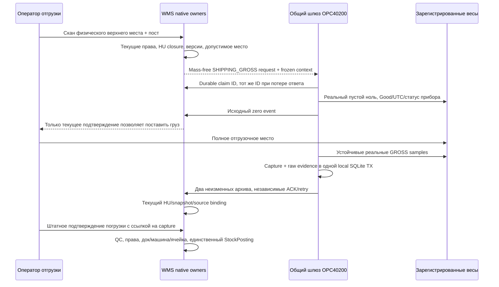

# SHIPPING_GROSS: целое отгрузочное место

Статус: предложение следующего инкремента, **API/SQL/UI не реализованы**. Подключение конкретной модели весов и физический пилот впереди. Основная архитектура остаётся [OPC40200 gateway](weighing-gateway-opc40200.md); этот документ уточняет отдельный предметный сценарий.

## Текущая граница

| Работает в текущем коде | Чего это не доказывает |
|---|---|
| CASE EMPTY_TARE/FINAL_GROSS + отдельный ASM_FINAL snapshot | Универсальное взвешивание произвольной паллеты/HU или автомобиля |
| Отдельное аппаратное основание CASE контроля | Разрешение отгрузить груз из служебной blocked CPT |
| Transport `LoadingRequest.measurements.origin=MANUAL_CONFIRMED` | Автоматический приём аппаратного capture вместо ручной массы |
| Frozen composition/версии существующего HU loading | Наличие нового SHIPPING_GROSS capture/claim/consumer |
| Магазинный actual GROSS своей поставки | Сопоставимость с GROSS родительской паллеты, если магазин получает только часть |

Источники: [transport loading DTO](../../api/wms_api_server/app/modules/transport/api/loading_routes.py), [warehouse HU measurements](../../api/wms_api_server/app/modules/inventory/api/warehouse_hu_routes.py), [ASM_FINAL](../../wiki/database/retailcase_assembly_final_snapshot_20261015.md). Штатный stock writer и shipping guards сохраняются.

## Целевой процесс

Новый замер относится к **одному физическому верхнему грузовому месту**. Скан — generic идентификатор паллеты/HU: разрешённый внутренний/legacy UID либо SSCC. Не надо превращать все поля в SSCC-only. Весы погрузчика или автомобильные весы не считаются автоматически эквивалентом платформенных весов для этого места: нужен отдельный commissioned профиль и предметный контекст.

## Серверный контекст и идентичность

Сервер после физического скана формирует отдельную domain identity `SHIPPING_GROSS` с собственной версией схемы, например `SHIPPING_GROSS/1`. Это **предлагаемое имя**, не зарегистрированная текущая signature version. Число3 само по себе неоднозначно: уже существуют legacy SMALL_HU/3 и отдельный domain ASM_FINAL/3.

| Поле | Предлагаемая связь |
|---|---|
| site_kind/site_id, station_id/device_id | Реальный склад/пост/зарегистрированное устройство и текущий dedicated sender |
| handling_unit.kind/identifier | Физически отсканированный верхний HU/паллетный UID, не номер задания |
| root content version + closure signature | Native состав со всеми CASE/child-HU/stock UID, количеством, единицей, версиями и действующими собственными резервами |
| shipment references | Отгрузочные документы, заказ/получатель и текущие fulfilment binding; gateway их не назначает |
| purpose/basis/unit | SHIPPING_GROSS / GROSS / KG без скрытого NET-преобразования |
| request_id/claim_id/capture_id | Frozen intent; claim_id совпадает с capture_id конкретной попытки, exact retry не меняет идентичность |
| scan evidence/operator | Серверная identity оператора и ссылка на исходный физический скан |
| packaging/tare reference | Только явное измеренное/разрешённое основание, когда оно действительно нужно; для GROSS отсутствие NET-расчёта нормально |

Для целого места нужен настоящий shipping-domain snapshot, допустимый текущим warehouse/shipping owners. Нельзя переиспользовать ASM_FINAL или обходить blocked-cell admission ради получения hash. Изменившиеся links, количество, container version, резерв/получатель или binding требуют новой подтверждённой identity. Несвязанные timestamps и комментарии не должны менять hash.

## API и native инкремент

Имена новых routes/DTO/raw protocol version должны быть отдельно заморожены перед кодом; действующих endpoints SHIPPING_GROSS сейчас нет. Нужны отдельные request/status/claim/zero/capture порты и архив/consumer, а не дополнительные поля существующего CASE DTO. Старые canonical EMPTY/FINAL/PICK/store bytes сохраняются.

Native first capture проверяет текущий original operator/scope, устройство/sender/calibration, claim fence, frozen snapshot, исходный zero event и реальный sample window. Archived exact ACK использует прежнее тело/время и текущую разрешённую identity: повтор не освежает измерение. Общий физический device lease обязателен для CASE, SHIPPING и иных адаптеров одного прибора.

Существующие120сек intent/30сек claim нельзя молча объявить нормой работы с тяжёлой паллетой. Сначала надо измерить безопасный цикл снять/ноль/подать/стабилизировать и согласовать bounded station timeout policy; изменение окна — versioned серверный контракт, без длинной удерживаемой Oracle TX. При неизвестном исходе/истёкшей lease нельзя автоматически генерировать новый ID и повторно мерить. Требуется настоящий native terminal/reconciliation механизм, ограждающий поздний first capture; HTTP404/409 не заменяет такой факт.

В `LoadingRequest.measurements` потребуется отдельный вариант аппаратного источника с capture reference. Точное имя нового origin ещё не выбрано; нельзя посылать аппаратную массу как MANUAL_CONFIRMED. Масса берётся из native archive, не из браузера. Размеры паллеты остаются самостоятельным источником данных: весы не измеряют высоту/ширину автоматически.

Consumer в том же native StockPosting контуре связывает capture с actual loading operation и frozen shipment. Нужны immutable capture-use/operation reference и exact replay без повторного списания. Архивирование веса само не меняет остатки, не заменяет QC/маркировку/допуск дока и не подтверждает departure. Raw OPC envelope хранится отдельно; нынешняя независимость capture/raw ACK не объявляется атомарной бизнес-гарантией без отдельного native guard.

## Сравнение с приёмкой магазина

Отгрузочный frozen shipment должен сохранить ссылку на GROSS именно того внешнего места, которое позже принимает магазин. Магазин сканирует его идентификатор и получает новый actual GROSS своими зарегистрированными весами. Стратегия приёмки, tolerances и подтверждение магазина остаются серверной политикой; gateway не объявляет «доставлено полностью».

Если паллету разобрали, перепаковали, убрали упаковку либо магазин принимает только часть общего HU, сравнение двух GROSS уже не равнозначно. Нужны новый физический child snapshot и отдельное исходящее взвешивание принятого места либо явное исключение/другая стратегия. Пропорциональное распределение массы по строкам, подмена NET/GROSS и вычитание паспортной тары без разрешённого основания недопустимы. Whole-vehicle loaded/empty weighing — отдельная будущая задача.

## Приёмка до пилота

Сначала pure/HTTP/fault и encrypted local OPC, затем изолированный native caller-rollback, только после этого отдельное разрешение на bounded quantity proof и canonical компенсацию. Матрица включает whole-HU/CASE children, generic UID/SSCC, новый child/версию после capture, чужую/отозванную область, параллельные шлюзы, stale timestamp/Bad/NULL/motion/overload/unit/tare, потерю каждого ACK и restart между local mirrors, late first capture, exact archive/loading replay, несовпадающее место на приёмке, разбивку паллеты, capacity/timeout.

Склад и магазин проходят независимое физическое commissioning: модель/профиль/сертификат, устойчивость/ноль/единицы, диапазон/дискретность, сканер, целое реальное место и безопасное время манипуляций. До этого software TEST не называется аппаратным пилотом. Native top SQL/планы измеряются на bounded closure до принятия индексов или load capacity.

## Read-only Python building block

Implemented separately: `app/modules/quality` immutable native-closure/archive projection and 37 pure tests. It computes direct-child expected mass, preserves unknown/estimated provenance and independent observed outer mass, and suppresses stale/expired comparisons. It does not verify producer authority/cryptographic proof or grant QC/loading release. No SHIPPING_GROSS API/native capture/consumer exists from this change. See [focused synthesis](../../wiki/concepts/retailcase_hu_mass_projection_20261015.md).
