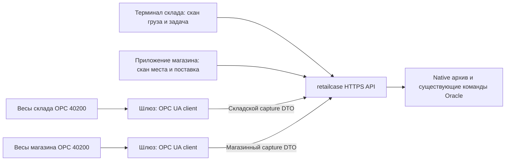

# Шлюз взвешивания: склад и магазин

Решение владельца от 15 октября 2026: **весы подключаются к шлюзу по OPC UA for
Weighing Technology (OPC 40200), шлюз подключается к retailcase по HTTPS API**.
Одна архитектура применяется при складском контроле перед отгрузкой и при приёмке
в магазине. Сканирование связывает физический груз с заданием; весы измеряют массу,
а решение о контроле, списании или приёмке принимает существующий сервер.

Целевая редакция — **2.00**, опубликованная 01.04.2025, namespace URI
`http://opcfoundation.org/UA/Scales/V2/`. Это URI модели, а не адрес подключения
конкретных весов. Поддержка 1.0/1.01 допускается только отдельным согласованным
профилем совместимости; она не считается автоматической совместимостью с v2.
[OPC Foundation: редакция и namespace](https://reference.opcfoundation.org/specs/OPC-40200).

## Состав системы

Шлюз — локальная служба на посту или в сети площадки. Один процесс может обслуживать
несколько весов, но каждое устройство имеет отдельную конфигурацию, последовательность
измерений и блокировку. Приёмщик работает в приложении; адрес OPC endpoint, сертификат
и NodeId он не вводит. Приложение показывает понятное имя поста и этап операции.

Модули шлюза: OPC UA connection/session manager; профиль модели и mapper узлов;
станционный координатор запросов; сборщик исходных наблюдений; локальный durable
outbox; HTTPS adapter магазина или склада; диагностика. `integrations` владеет
протоколом, `inventory` — складским архивом/CASE/QC, `delivery` — магазинным архивом
и приёмкой. Шлюз не хранит второй товарный баланс и не выполняет SQL напрямую.

## Контекст измерения и работа оператора

| На каком этапе | Физическое действие | Контекст сервера и результат |
|---|---|---|
| Склад: EMPTY_TARE | Скан пустой физической тары, проверка пустого состояния CASE, взвешивание | CASE/task/version, post_cell, scan_container; неизменяемая измеренная масса тары до первого наполнения |
| Склад: PICK | Скан исходной ячейки, контейнера и товара, взвешивание при существующем весовом CASE-отборе | CASE/task/line/content_version и точный источник; GROSS для соответствующей целой коробки или явно настроенный NET для допустимого развесного товара |
| Склад: FINAL_GROSS | Скан той же закрытой коробки/контейнера после сборки, взвешивание | Текущий состав CASE и ссылка на EMPTY_TARE; архив полного брутто, затем отдельная существующая команда независимого QC |
| Магазин: STORE_RECEIPT | Открыть поставку, физически отсканировать идентификатор места, выбрать весы, поставить груз и запросить вес | load_operation_id, store_address, frozen composition_signature; новое измеренное GROSS и отдельное подтверждение приёмки по стратегии магазина |

Поля идентификатора паллеты/контейнера должны принимать стандартные SSCC и внутренние
legacy идентификаторы там, где это разрешает соответствующий документ. Физический
скан не заменяется выбором строки списка. Складские native проверки для определённых
типов CASE/GS1 могут быть строже; шлюз не расширяет их допустимый формат.

Сценарий магазина: проверить пустую платформу → сканировать место → положить груз →
«Получить вес» → дождаться подтверждённого архива → проверить результат и фото →
«Подтвердить приёмку». Если ноль не был физически проверен, интерфейс предлагает
освободить платформу. Значение `zero_confirmed=true` не выставляется по умолчанию.
Обязательность физического скана относится к процессу приёмки; текущий запрос весов
сам содержит поставку/состав, а не поле сканирования.

Складской request/claim handshake реализован и применён 15.10.2026 поверх
существующих архивных API. Запрос и разрешение на измерение не содержат показания
массы. Нельзя отправлять магазинный request в складской endpoint.
Отдельного нового capture purpose `LOADING_QC` сейчас нет: финальный контроль
выполняет существующий OUTGOING_PALLET_CHECK, после него погрузка использует принятый
исторический факт. Новый этап измерения на воротах — отдельное согласование сценария.

## Целевой общий CaptureContext

Это проект следующего серверного контракта, не дополнительные поля нынешнего
capture DTO. Он связывает любое измерение с конкретным физическим грузом:

| Поле | Смысл и проверка |
|---|---|
| site_kind / site_id | WAREHOUSE с реальным WARE_ID или STORE с текущим идентификатором магазина; проверка области прав сервером |
| station_id / device_id | Зарегистрированный пост и назначенные ему физические весы |
| purpose | Реализованные PICK/EMPTY_TARE/FINAL_GROSS, STORE_RECEIPT в своём адаптере; проектируемый SHIPPING_GROSS для целого отгрузочного места |
| handling_unit.identifier / identifier_scheme | Физически отсканированный идентификатор паллеты, коробки или контейнера; SSCC либо разрешённый внутренний/legacy идентификатор |
| document_id / snapshot_signature / snapshot_version | Серверный документ и замороженный состав именно этого груза; не присылаемый шлюзом новый состав |
| request_id / capture_id | Неизменная корреляция задания и замера; повтор доставки сохраняет оба идентификатора |
| actor_id / source_scan_ref | Серверная identity оператора и ссылка на подтверждённый физический скан |
| basis / unit / tare_reference | Явный GROSS/NET, KG и источник измеренной тары при необходимости |

Сервер выдаёт контекст после скана и проверки документа; шлюз не назначает себе
площадку, состав или права. Сохранённый контекст получает подпись/версию и валидируется
снова при фиксации. Current adapters проецируют только разрешённые поля в свои
строгие DTO из таблицы endpoints ниже; недостающая семантика требует versioned
серверного расширения, а не потери полей при преобразовании.

### Целая паллета на отгрузке — отдельный целевой сценарий

Существующий FINAL_GROSS относится к **CASE** и его measured EMPTY_TARE. Он не
является готовым универсальным endpoint для произвольной паллеты, транспортного
контейнера или автомобиля. В текущем ordinary HU loading масса может опираться
на MANUAL_CONFIRMED; это не аппаратное взвешивание всей паллеты.

Для требуемого контроля целой отгрузочной паллеты проектируется purpose
**SHIPPING_GROSS**: скан идентификатора паллеты → серверный frozen composition
snapshot → станционный request/lease → OPC GROSS → неизменяемый capture →
штатный контроль перед погрузкой → ссылка на аппаратный факт в frozen shipment.
Нужны отдельные серверные API/native архивная привязка к HU/snapshot и адаптер
погрузки, совместимый с текущим единственным stock writer. Если физическая
паллетная тара нужна для NET, её measured reference передаётся отдельно;
для сравнения в магазине используется GROSS того же внешнего места.

Это следующий интеграционный инкремент, **не уже работающий режим** существующего
`/final-captures`. Тот же OPC шлюз/zero/quality/native sample validator переиспользуются;
новая предметная привязка не создаёт второй алгоритм устойчивости. Взвешивание
автомобиля и разница loaded/empty vehicle — иной контекст, не эквивалент одной
паллеты и не заменяет её измерение.

## Сборка накидыванием: товар к человеку

Решение владельца от 15.10.2026: поддержать goods-to-person, когда товар подаётся
оператору, а сборочная тара постоянно находится на весах. Терминал фиксирует,
какой товар и в каком количестве положен; весы подтверждают изменение массы.
После последней укладки требуется отдельный финальный вес. Это целевой новый
режим **INCREMENTAL_ASSEMBLY**, а не уже доступная возможность текущего PICK DTO.
Подтверждение массы не определяет артикул и не заменяет сканирование товара.

Последовательность работы:

1. Оператор входит в назначенный пост, сканирует задание и идентификатор сборочной
   тары. Сервер проверяет исполнителя, склад, источник товара, состав и доступный
   остаток. Пост получает исключительное владение весами и этой сборкой.
2. Пустую платформу проверяют на ноль, затем устанавливают пустую тару и сохраняют
   её измеренный вес. Для возобновляемой сборки текущий вес сверяется с последним
   подтверждённым состоянием; его нельзя объявить новой пустой тарой.
3. До укладки сервер открывает шаг конкретной строки/подачи и сохраняет устойчивый
   **W_before**. Терминал показывает товар, количество и сборочную тару. Только
   затем появляется команда «Положите товар». Оператор сканирует поданный товар
   и кладёт требуемое количество в сборку.
4. Подтверждение укладки имеет два режима по настройке поста:
   **по кнопке «Положил»** либо **автоматически по стабилизации веса**.
   В автоматическом режиме после скана и открытия шага шлюз ждёт фактическое
   изменение относительно W_before, затем устойчивую серию **W_after**.
   Исходное неизменное плато не считается укладкой. Устойчивость фиксируется
   без нажатия кнопки; сервер проверяет delta и остальные условия шага.
   В ручном режиме нажатие фиксирует намерение оператора, но также требует
   подтверждённой устойчивой серии. Если изменение произошло до нажатия,
   нужны сохранённые наблюдения именно открытого окна; неизвестный прежний
   вес не восстанавливается расчётом.
5. Сервер проверяет delta = W_after − W_before, качество и время наблюдений,
   неизменность тары/состава, скан и количество. При принятии связывает оба
   capture с единственным фактом отбора и новой версией состава. Только после
   этого терминал показывает «Укладка подтверждена» и выдаёт следующий шаг.
6. После последней строки оператор нажимает **«Завершить сборку»**. Выполняется
   новое устойчивое финальное измерение с собственной identity. Сервер сверяет
   его с последним принятым весом и всей цепочкой, фиксирует финальный состав
   и направляет сборку в существующий контроль/отгрузку.

На одном шаге допускается несколько единиц **одной строки** в указанном количестве.
Одновременная укладка разных артикулов не допускается: одно изменение массы не
позволяет подтвердить отдельные действия. Для нескольких сборок на посту нужны
отдельные весовые каналы или явная смена тары с завершением/сверкой предыдущей;
одна платформа не подтверждает независимо несколько заказов.

#### Правила проверки и допуска

- W_before — последний принятый устойчивый вес этой физической сборки,
  подтверждённый свежим предоперационным окном. Весы не тарируются после каждой
  укладки: сохраняется непрерывная цепочка брутто и одна исходная тара.
- Для штучного товара ожидаемый прирост определяется сервером по количеству,
  упаковке и нормативной массе/диапазону. Допуск задаётся версионируемой политикой
  товара/поста с учётом дискретности и допустимого разброса; универсального
  процента для всех товаров нет. Масса транспортного лотка подачи не включается,
  если он не остаётся в сборке. Развесной товар требует отдельной разрешённой
  политики количества по измеренной массе.
- При неизвестной нормативной массе прибор подтверждает только факт измеренного
  прироста. Автоматически утверждать правильность количества нельзя: нужен
  установленный альтернативный контроль. Прирост ниже надёжно различимого
  диапазона прибора также не получает автоматическое подтверждение.
- Изменение массы вне открытого шага, отрицательная delta, перегрузка, касание
  платформы, снятие тары, потеря качества или неожиданный скачок переводят пост
  в разбор расхождения. Следующая укладка блокируется до восстановления контекста.
- Исправление укладки — отдельное авторизованное действие удаления/возврата со
  своей отрицательной delta и ссылкой на исходный шаг. Перезапись принятого
  capture, тихий сброс нуля и автоматическое уменьшение количества запрещены.
- Финальный вес не копируется из W_after. Проверяются новая стабильная серия,
  отсутствие незавершённых шагов и соответствие текущей версии состава. Сверка
  с исходной тарой и суммой принятых delta использует согласованный накопленный
  допуск. Добавление крышки/обвязки фиксируется отдельным шагом упаковки, чтобы
  реальная упаковочная масса не выглядела необъяснимой разницей.

#### Целевой контракт, восстановление и UI

Новый серверный контекст включает assembly_session_id, task/line/source,
handling_unit, station/device, actor, sequence, quantity/UOM, expected_content_version,
operation_id, request_id, before_capture_id, after_capture_id, policy_version и
итоговую delta. Сервер хранит неизменяемую цепочку подтверждённых шагов. Числа
из терминала не служат аппаратным фактом; шлюз передаёт исходные измерения.
Точные имена применённого первого инкремента зафиксированы в [Assembly API v1](../../coordination/retailcase-claude/ASSEMBLY_SCALE_API_V1.md) и native миграциях. Расширенные типы шагов не добавляются в старые strict DTO без версии.

Состояния интерфейса: «Подготовка весов» → «Положите товар» → «Проверяем вес» →
«Укладка подтверждена»; отдельно «Расхождение», «Восстановление связи» и
«Финальный контроль». На экране — активная сборка/товар/количество, ожидаемый
и фактический прирост, текущий вес и причина блокировки. Кнопки имеют подсказки
и ссылки на соответствующий раздел встроенной справки. Технические NodeId и
сертификаты находятся в диагностике поста.

Режим подтверждения и версия политики фиксируются при открытии шага; переключать
их в незавершённом шаге нельзя. Идентификатор operation_id выделяется и сохраняется
до физической укладки также в автоматическом режиме. Повторные сигналы Stable и
новые отсчёты того же плато относятся к одному шагу и не создают новых отборов.
Следующий шаг открывается только после серверного подтверждения предыдущего и
нового скана/разрешённой подачи. Окно устойчивости, минимальный различимый прирост,
допуск и timeout задаются проверенным профилем, а не универсальной задержкой.
Если прирост не соответствует полному количеству открытого шага, устойчивое
плато само по себе не подтверждает укладку. Частичные добавления допускаются
только явно настроенным сценарием с проверкой накопленного прироста. При timeout
или неоднозначности показывается причина и требуется разбор, без автоматического
приписывания товара и количества. Терминал даёт звуковой/визуальный сигнал после
серверного принятия; локальный Stable отдельно означает лишь «Вес стабилен».

Намерение сохраняется до отправки. При потере ответа повторяются прежние
operation_id и тело; результат читается на сервере, следующий шаг не начинается
до выяснения исхода. Один capture нельзя использовать в двух укладках; роль
after одного шага и before следующего допускается только как явно связанная
опорная точка с новым свежим наблюдением, а не как второе событие отбора.
При разрыве OPC до достаточного evidence шаг не подтверждается. После reconnect
нельзя приписать неизвестный прирост последнему товару: сверяются физическая
сборка, последнее серверное состояние и новая серия, при неоднозначности нужен
контролёр. Незавершённые укладки offline не засчитываются автоматически.

Ожидание человека/весов не удерживает Oracle-транзакцию. После получения evidence
короткая серверная команда атомарно связывает capture, факт отбора, версию состава
и штатные исходящие события через существующий stock writer. Архивирование
наблюдения отдельно не означает движения товара. Параллельный исполнитель,
устаревшая версия, повтор с другим телом и отозванное право отклоняются сервером.

Приёмка режима включает нормальную цепочку и финал, неверный товар/количество,
два одновременных шага, недопустимый малый прирост, постороннее изменение,
коррекцию/упаковку, снятие тары, потерю ответа после commit и OPC reconnect.
Проверяются один факт отбора на шаг, неизменяемые ссылки evidence и отсутствие
дублирования выработки. Первый инкремент ordinary EA и отдельный финал проверены программно; расширенные коррекции/упаковка и физический пилот требуют самостоятельной приёмки. Существующие архивы CASE сами по себе не доказывают готовность всех этих вариантов.

## От модели OPC UA к измерению

У `ScaleDeviceType` есть `CurrentWeight` типа `WeightItemType`. Составное значение
`WeightType` содержит **Gross, Net, Tare** типа Double. Это три разных величины,
не три синонима поля weight. Их смысл и типы определены стандартом.
[ScaleDeviceType](https://reference.opcfoundation.org/specs/OPC-40200/7.4),
[WeightType](https://reference.opcfoundation.org/specs/OPC-40200/10.3).

| Источник OPC UA | Что хранит/проверяет шлюз | Проекция в существующий API |
|---|---|---|
| `CurrentWeight` / `WeightType.Gross` | Исходное значение и выбранный basis | store `samples[].gross_weight_kg`; warehouse GROSS `samples[].weight_kg` |
| `WeightType.Net` / `WeightType.Tare` | Раздельные исходные величины, согласованная семантика тары | NET — только настроенный складской PICK; не подставлять в магазинное GROSS |
| `0:EngineeringUnits` (`EUInformation`) | Namespace/unit identifier и разрешённая единица профиля, не один текст display name | Текущие DTO принимают только `KG`; неверная единица блокирует capture |
| `Overload`, `Underload`, `TareMode` | Фактическое состояние устройства | Ошибка диапазона/неразрешённая preset tare блокирует capture; поля не добавляются в старый DTO |
| `WeightStable`, `CenterOfZero` | Свидетельство устройства, если поддерживается согласованным профилем | Stable не заменяет native проверку samples; zero_confirmed — только по действительной проверке нуля |
| DataValue `statusCode`, `sourceTimestamp`, `serverTimestamp` | Качество и происхождение времени каждого наблюдения | Текущий DTO получает measured_at/offsets; полный OPC evidence требует отдельного расширения архива |

`Overload`, `Underload`, `TareMode` обязательны в определении `WeightItemType`,
а `WeightStable` и `CenterOfZero` опциональны. Для нашего закупочного профиля
требуем доступное подтверждение устойчивости и нуля либо явно проверенный
эквивалент производителя; отсутствие optional узла не означает false/true.
Без WeightStable или доказанного эквивалентного сигнала профиль не допускается
к аппаратной приёмке: пять близких чисел сами не доказывают флаг устойчивости прибора.
`EngineeringUnits` наследуется от `MeasuredItemType` и описывает все три массы.
[WeightItemType](https://reference.opcfoundation.org/specs/OPC-40200/9.3),
[MeasuredItemType](https://reference.opcfoundation.org/specs/OPC-40200/9.2).

В проверенной модели v2.00 не используем выдуманный универсальный
`ControlInformationType`. Состояния читаются из фактических типов/свойств выше
и согласованного паспорта модели. NodeId конкретного устройства выдаёт поставщик.
Шлюз разрешает namespace по **URI**, не фиксирует условный `ns=2` для всех серверов;
сохраняет ExpandedNodeId/путь, тип, BrowseName с namespace и версию профиля. После
перезапуска или обновления прошивки проверяет модель заново.

Double переводится в decimal representation по проверенному профилю устройства;
NaN/Infinity, отрицательная недопустимая масса и off-grid значение не исправляются
молчаливым округлением. Исходный Double и его тип сохраняются в evidence.
Высокое разрешение/PrintableValue не выбирается автоматически вместо штатного
измеренного значения. Предел/дискретность/поверка сравниваются с серверной политикой,
изменение настроек не становится новой policy без администрирования.

## Подписки, качество и время

Шлюз создаёт session и подписку на вес и необходимые связанные состояния, с
согласованными sampling/publishing interval, queue size и контролем переполнения.
Для захвата сохраняет 5–25 **реальных** наблюдений в поддерживаемом окне; окончательный
разброс, кратность дискретности и допустимость пакета проверяет один native
`RRL_SCALE_PACKET_READ`. Значение последнего sample не заменяется средним.

Одинаковая масса не обязана порождать новые data-change notifications. Нельзя
копировать одно cached значение пять раз с новыми timestamps. Для подтверждения
неизменного веса профиль предусматривает периодические действительные Read либо
согласованный режим уведомлений/регистрации, который позволяет доказать наблюдение
в каждом sample. Пропуски, queue overflow и разрыв session обрывают текущее окно.

`DataValue` передаёт value, StatusCode и отдельно source/server timestamps.
SourceTimestamp отражает время источника и не переписывается при перепередаче;
ServerTimestamp может подтверждать актуальность неизменившегося значения.
Поэтому давний source timestamp у постоянного веса сам по себе не доказывает
неисправность. Нужны также свежесть server observation, качество и согласованное
поведение сервера. Null timestamps сохраняются как null, не заменяются выдуманным
временем устройства. [OPC UA Part 4: DataValue](https://reference.opcfoundation.org/specs/OPC-10000-4/7.11).

Правила retailcase: Bad/Uncertain/null value не участвуют в capture; пропавший
обязательный timestamp или неоднозначное происхождение времени блокируют приёмку
оборудования до согласования профиля. Шлюз хранит исходные времена без изменения,
своё observed_at и монотонные offsets отдельно. Часы площадки синхронизируются;
скачок времени/запоздалое наблюдение не маскируется новым measured_at.

## Запрос, конкурентный доступ и восстановление

Для магазина уже реализован HTTPS v1: приложение создаёт `/requests`, выделенный
sender опрашивает `/gateway/requests?device_id=…`, шлюз отправляет `/captures` с
`capture_id=request_id`, приложение читает `/requests/{request_id}`.
Текущие серверные состояния — **REQUESTED, CAPTURED, STALE, EXPIRED**.
STALE означает потерю актуальности источника/policy/device; CAPTURED не означает
«магазин принял поставку». Cancellation, heartbeat и MEASURING пока не являются
реализованными endpoint/state этого контракта.

Сервер допускает один действующий запрос на устройство. Реализована отдельная
локальная SQLite lease физического устройства, общая для складского и магазинного
OPC исполнителей, и отдельная lease доставки outbox. Первый coordinator собирает
исходные наблюдения; другой локальный процесс не смешивает с ними свой буфер.
Складской серверный claim дополнительно связывает отправителя, CASE и срок
измерения. Все процессы поста должны использовать общий каталог lease; это не
распределённая блокировка разных компьютеров и не аппаратная аттестация. Новый
owner получает новое окно и не продолжает чужую серию.

До HTTP POST готовый пакет записывается в durable outbox. При потере ответа шлюз
повторяет исходный пакет и прежние device/capture IDs; конфликт содержимого
блокируется. ACK сверяется с identity, грузом/магазином, canonical source SHA,
policy/calibration/time и последним sample. Сбой после фиксации не создаёт второй
замер. Повтор 5xx/timeout — backoff; 401/403/409/422 — диагностика по классу ошибки,
без автоматической подмены source или capture ID.

После OPC reconnect пересоздаётся session, проверяются сертификат/namespace/profile/policy,
незавершённое sample окно удаляется. Текущий клиент читает окна значений; режим
subscriptions и восстановление подписок остаются отдельным вариантом реализации.
Ранее зафиксированный capture остаётся для exact retry. Исторический capture не
получает свежий measured_at. Молчание устройства и состояние outbox отображаются
раздельно; доступность HTTPS не означает доступность весов.

## Два действующих payload, один принцип

| Назначение | Endpoint | Отличающиеся поля |
|---|---|---|
| Складской PICK | `POST /api/inventory/warehouse-scales/captures` | post_cell, case_task_id, case_line_id, expected_content_version, scan_source_cell/container/product, basis NET/GROSS, samples[].weight_kg |
| Тара/финальный CASE | `POST /api/inventory/warehouse-scales/final-captures` | purpose EMPTY_TARE/FINAL_GROSS, case_task_id, expected_content_version, scan_container, tare_capture_key, basis GROSS, samples[].weight_kg |
| Приёмка магазина | `POST /api/delivery/store-scales/captures` | load_operation_id, store_address, basis GROSS, samples[].gross_weight_kg; request_id передаётся как capture_id |

Для всех есть устройство, capture identity, версия политики, calibration,
проверка нуля, измеренное время и исходные samples. **Форматы не взаимозаменяемы**.
`HttpScaleGateway` обслуживает магазин; отдельный складской HTTPS adapter и его
строгий ACK validator реализованы. Переключать URL у магазинного DTO нельзя.

## Брутто, тара и сравнение двух площадок

На складе EMPTY_TARE — реальная масса пустого физического контейнера. FINAL_GROSS —
реальное брутто того же контейнера с текущим составом. Native вычисляет net = gross
минус эта measured tare **один раз**, связывает capture с независимым QC и не
подменяет тару справочным весом. При погрузке принятые массы/версии/capture/QC
замораживаются в существующем shipment manifest.

В магазине новое actual GROSS сравнивается с **shipping_gross_weight_kg той же
замороженной поставки**. Повторная тара или справочный net в сравнении не вычитаются.
Если магазин взвешивает часть мест, распакованный товар или другую внешнюю тару,
это другой контекст: нельзя сравнивать его с полным отгрузочным GROSS. Для
WEIGHT_PHOTO требуется существующее полное покрытие измеренных коробок и фото;
превышение допуска обрабатывает штатный акт расхождений. Допуск бизнес-контроля
не является погрешностью прибора и не меняется шлюзом.

Для обычных BOX пока существует MANUAL_CONFIRMED отгрузочный источник; для
поддерживаемого малого CASE — actual measured archive + accepted QC. Старый ручной
источник не становится HARDWARE от появления OPC шлюза. Расширение аппаратного
контроля на все типы отгрузочных мест — явная следующая интеграция с владельцем
погрузки, с сохранением текущего frozen manifest и одного stock writer.

## Полное исходное OPC evidence — отдельный версионированный контракт

Текущие strict DTO запрещают неизвестные поля. Поэтому statusCode, NodeId,
sourceTimestamp/serverTimestamp, server certificate fingerprint, session/profile
version и raw Gross/Net/Tare **не добавляются самовольно** в `/captures`.

Реализован отдельный envelope/archive `POST /api/integrations/scale-evidence`:
устройство/контекст/capture identity, namespace/model/profile, исходные DataValues
с quality и исходными timestamps, observed_at, единицы и SHA capture DTO. Версия1.0
покрывает магазин/склад PICK/FINAL,1.1 — BEFORE/AFTER сборки,1.2 — сверку после
расхождения. Strict header должен совпадать с версией тела. Ограничение — 128KiB.
Native архив проверяет исходного отправителя, контекст и точное соответствие
сохранённому capture; уже сохранённые записи неизменяемы. Локальный атомарный bundle
готовит capture/raw вместе, но HTTP ACK capture и ACK raw — отдельные транзакции.
Поэтому локальная запись и даже принятый capture сами по себе не означают, что
raw уже сохранён на сервере: подтверждение raw должно иметь binding MATCHED. Это
свидетельство шлюза, а не аппаратная подпись или метрологическая аттестация.

## Паспорт поставщика и защита

Поставщик передаёт модель/серийный номер/прошивку, OPC 40200 v2 conformance profile
и NodeSet, реальные endpoint/namespace/BrowsePaths/NodeIds, поддержку нужных
полей, режим стабильности/нуля/тары, KG/диапазоны/дискретность и поверку.
Приёмка включает clock provenance, поведение неизменного веса, reconnect и
переполнение очередей. Для отсутствующего optional свойства нужен проверяемый
согласованный профиль, а не предположение интегратора.

Требование развёртывания: OPC UA SignAndEncrypt с согласованной актуальной security
policy, взаимное доверие сертификатам/rotation/revocation и account только на
нужные read/subscribe операции. Автоматического доверия новым сертификатам нет.
SetZero/SetTare/SetPresetTare и calibration из интерфейса приёмки не разрешены.
Шлюз ходит в WMS по HTTPS с выделенным sender, отдельно от учётной записи
приёмщика/контролёра; сеть и ACL outbox ограничены площадкой. Секреты не попадают
в capture/diagnostics. Сертификат OPC не заменяет права WMS и поверку весов.

## Ввод на складе и в магазине

| Проверка | Складской пост | Магазинный пост | Ожидаемый результат |
|---|---|---|---|
| Идентификатор/контекст | Чужие CASE/version/post или скан | Чужое место/store/load/signature | Отказ до бизнес-эффекта |
| Тара/базис | EMPTY_TARE → заполнение → FINAL_GROSS | Пустая платформа → actual GROSS | Раздельные gross/tare/net; preset не маскирует массу |
| Качество/предел | Bad/Uncertain/null/overload/underload | То же | Нет пригодного capture и ложной готовности |
| Время/единицы | Старые/пропавшие времена, скачок часов, не KG | То же | Явная диагностика, без скрытой конверсии/refresh |
| Устойчивость | Движение, постоянный вес, реальные samples | То же | Нет синтетических samples; native validator единственный |
| Повтор/параллель | Два owner/команды на один capture | Два запроса/повтор после timeout | Один владелец окна, один архив, once-use в native команде |
| Потеря связи | OPC/TLS/WMS/outbox restart | То же | Незавершённое окно отброшено; готовый пакет повторён неизменно |
| Отзыв/перенастройка | Sender/WARE/device/policy/calibration | Receiver/STORE/sender/device | Текущие права соблюдены; старый ACK не расширяет доступ |
| Сквозной результат | Принятый QC → frozen shipment | Тот же manifest → приёмка/акт | Сверяем фактическое брутто одного и того же состава |

Сначала интеграционный стенд и независимая проверка профиля, затем один складской
пост и один магазин на общей тестовой поставке, затем пилот с журналом измерений
и анализом долгих SQL, после него тиражирование. Изменение устройства/прошивки/
namespace/security profile повторяет соответствующие проверки.

## Что уже есть, что требуется сделать

**В коде/native:** складские архивы187/204 и once-use188/205, перенос принятых
CASE масс в frozen shipping207, магазинный capture/receipt, store request handshake,
HTTPS клиент и durable outbox. Их тестовые пакеты и локальный HTTP стенд не
являются испытанием физического OPC оборудования.

**Дополнительно реализовано 15.10:** исполняемый OPC UA read-window клиент,
профили commissioning, локальная общая lease устройства, исходные clock/quality
evidence, versioned raw archive, складской request/claim/HTTPS/ACK и ZERO progress,
сборочный BEFORE/AFTER и отдельный ASM_FINAL. Опциональный asyncua установлен в
изолированном окружении шлюза; обычный API не требует его при импорте. Локальные
зашифрованные TEST OPC проверки с настоящими HTTP/Oracle выполнены.

**Остаётся:** выбранные реальные модели/профили поставщиков и commissioning,
аппаратная/метрологическая приёмка, полный SHIPPING_GROSS паллеты, расширенные
коррекции/упаковка, subscriptions при необходимости и сквозной физический пилот
склада и магазина. Диагностика/heartbeat не должны подменять факт измерения.

Техническая совместимость текущего магазина: [HTTPS v1 и JSON Schema](store-scale-protocol-v1.md).

## Реализованный складской обмен и подтверждение нуля · 15.10.2026

Серверная очередь обслуживает `EMPTY_TARE`, допустимый существующий `PICK` и
`FINAL_GROSS`. Терминал отправляет `POST /api/inventory/warehouse-scales/requests`
с исходным `request_id`, CASE, устройством, версией состава и физическим сканом.
Выделенный отправитель устройства получает очередь и выполняет
`POST /api/inventory/warehouse-scales/gateway/requests/{request_id}/claim`.
Срок запроса — 120 секунд, одного разрешения — не более 30 секунд и не позже
окончания запроса. Первый замер должен быть получен и принят в этом разрешении.
Исторический точный повтор сохранённого результата сохраняет исходное время;
повтор не превращает старое измерение в новое.

Новый терминальный запрос явно включает `zero_progress_required:true`.
У старого запроса поле отсутствует: сервер и SDK не добавляют `false` и не меняют
его исходные канонические байты. Данные массы оператор не вводит. После получения
разрешения шлюз действительно читает пустую платформу по OPC UA, проверяя
Gross/Net/Tare=0, устойчивость, центр нуля, отсутствие перегрузки/недогрузки,
режим тары, единицы, Good и времена исходных DataValue. Сохранённое до запроса
показание нуля для этого шага не подходит.

Шлюз долговечно сохраняет исходное свидетельство и передаёт его на
`POST /api/inventory/warehouse-scales/gateway/requests/{request_id}/zero-confirmed`.
Тело содержит `claim_id`, `device_id`, `zero_observed_at`, `zero_source_sha256`,
точную строку `zero_evidence_json`, `profile_sha256`, `unit_namespace_uri`,
`kg_unit_id`, `no_tare_mode`. Последние поля описывают согласованный профиль
шлюза: это `GATEWAY_REPORTED`, а не сертификат поверки или аппаратная аттестация.
Исходный JSON и SHA256 фиксируются неизменно; другой отправитель или изменённое
тело не получают исходную квитанцию.

Ответ разделён на неизменный `receipt` и текущий `current`. Историческое
`receipt.zero_confirmed=true` само по себе не разрешает ставить груз. Операторский
`GET /api/inventory/warehouse-scales/requests/{request_id}` показывает:

| Этап | Что показывает терминал |
|---|---|
| `WAITING_ZERO` | Освободите платформу, ожидайте подтверждения нуля |
| `ZERO_CONFIRMED` и текущий `load_allowed:true` | Можно установить соответствующую пустую тару или полную сборку |
| `CAPTURED` | Замер сохранён; дальнейшее действие подтверждает отдельный бизнес-владелец |
| `INACTIVE`, истёкшее разрешение, отзыв или недоступный сервер | Инструкция установки груза отключена; прочитайте текущий результат |

Разрешение действует только для текущего CASE/поста/состава/назначения и живого
claim. Терминал использует `server_now` и `claim_expires_at`, учитывает время
доставки ответа и выключает разрешение при истечении срока даже без следующего
ответа опроса. После подтверждённого нуля шлюз ожидает реального появления груза,
а затем новой устойчивой серии. Он не архивирует пустую платформу как финальный
вес, пока человек читает инструкцию. Native архив связывает `zero_check_at`
и точное `zero_check_kg=0` с этим сохранённым нулём. При сбое повторяются прежние
сохранённые байты; истёкшая квитанция не даёт разрешения на новую укладку.

У `FINAL_GROSS` необходимо различать назначения. Для обычного контроля отгрузки
сохраняется его прежняя идентичность и условия shipping QC. Для собственного
поста сборки используется явный `signature_domain:"ASM_FINAL"` с версией3:
проверяются текущие CASE/назначение/строки, физические партии и HARD-резервы,
версия поста/тары и привязка к подготовленной СТ. Такая квитанция завершает
весовую сборку и не является разрешением QC на отгрузку. Одной версии3 для
определения назначения недостаточно: существующий SMALL_HU также использует3.

Проверено на зашифрованном локальном OPC UA сервере с настоящими HTTP и Oracle:
EMPTY → BEFORE → AFTER → единственный CASE_PICK_CONFIRM → закрытие/привязка СТ →
отдельный FINAL → FINALIZED; точные повторы не создают повторного отбора.
Тестовый товар возвращён штатными компенсирующими командами, история сохранена.
Подтверждение нуля отдельно проверено на изолированном CASE: 15 native проверок,
реальные HTTP, истёкшее первое подтверждение, неверная масса/время, отзыв и
append-only. Это программная проверка; модель весов, поверка и физический
пилот склада/магазина ещё не подтверждены. Полное `SHIPPING_GROSS` отгрузочной
паллеты остаётся отдельным инкрементом и не подменяется малым CASE.

Источники реализации: [очередь](../../wiki/database/retailcase_warehouse_scale_requests_20261015.md),
[ноль](../../wiki/database/retailcase_warehouse_scale_zero_progress_20261015.md),
[финальный состав сборки](../../wiki/database/retailcase_assembly_final_snapshot_20261015.md),
[полный программный сценарий](../../reports/retailcase/2026-10-15/assembly-scale/finish-native-http.json).

## Вложенные паллеты и смешанная сборка · проект AK06-F

Шлюз должен обслуживать не только отдельную сборку, но и внешнее грузовое место,
собранное из нескольких вложенных мест. В одном дереве могут находиться CASE,
собранные на весах, и коробки/поштучные сборки со стеллажа. Сохраняются исходные
SSCC либо внутренние идентификаторы и собственные основания каждого ребёнка.
Существующее HU-дерево используется повторно; перечисленные ниже дополнения
SHIPPING_GROSS ещё требуют реализации и сквозной приёмки.

Сервер фиксирует корень, версию и точный состав дерева до запроса внешнего веса.
Профиль назначения и подпись состава отличают внешний SHIPPING_GROSS от
ASM_FINAL ребёнка. Шлюз получает готовую идентичность запроса и читает физические
весы; он не строит дерево, не объединяет склады и не изменяет количества.
Изменение потомка, упаковки либо связи до принятия результата требует нового
актуального допуска. Старое измерение и исходные байты остаются в истории.

Фактический GROSS внешнего места — самостоятельное измерение. Расчётный ожидаемый
вес складывается только из GROSS непосредственных детей и собственной тары и
упаковки текущего узла. Тара вложенных уровней повторно не прибавляется. Если
масса одного ребёнка не подтверждена, ожидаемый итог и сравнение остаются UNKNOWN;
это не отменяет реально измеренный внешний GROSS и не превращает его в MATCHED.
Вес внешней паллеты не становится одновременно весом каждой дочерней СТ и не
подтверждает артикулярный состав либо количество.

Сначала выполняются штатные физические перемещения и окончательная упаковка,
затем требуемый текущий контроль детей и независимое взвешивание внешнего места.
ASM_FINAL сохраняет историю весовой сборки; он не заменяет shipping QC. Для
консолидации овощей/фруктов и охлаждённых продуктов отдельно проверяются режим,
упаковка, зона и санитарная совместимость; сам шлюз весов такой допуск не выдаёт.

В магазине внешний вес сравнивается с целой поставкой только при принадлежности
всего состава этому магазину. Если маршрутная паллета содержит несколько магазинов,
приёмка требует штатной выдачи собственного поддерева и соответствующего ему
веса/стратегии; полный вес внешней паллеты не сравнивается с частичной выдачей.
Идентичность приёмки связывает frozen отгрузку и конкретную выдачу/поддерево.

Границы существующего ядра и план: [проверка матрёшки](../../wiki/concepts/retailcase_nested_hu_consolidation_20261015.md),
[AK06-F](../../wiki/roadmap/retailcase_access_knowledge_plan.md),
[проект SHIPPING_GROSS](shipping-gross-proposed.md).

### Confirmed TEST zero/claim clock boundary (2026-10-15)

The root-run scoped ordinary CASE EMPTY test exposed a real clock boundary: the first genuine OPC zero read after claim HTTP ACK still had instrument/server timestamps20?25ms before Oracle claim creation. Native rejected it with WH_ZERO_OBSERVATION_OUTSIDE_CLAIM. The original event and409 are preserved; it is not a confirmed zero. The gateway now waits for a newly read zero with observed_at and all seven original DataValue server timestamps inside the server claim window BEFORE durably staging the event. It never replaces instrument timestamps or relaxes native checks. Saved events remain immutable on retry; persistent clock skew expires safely without a new staged zero.

After authoritative original expiry and zero/capture absence, a separately reviewed requestB completed encrypted OPC ? native ZERO_CONFIRMED ? actual TEST0.5kg EMPTY capture ? raw MATCHED. [Actual evidence](../../reports/retailcase/2026-10-15/case-scoped-close/empty-1939b.json), [failure and correction](../../reports/retailcase/2026-10-15/warehouse-empty-scoped/producer-zero-clock-diagnosis.md), [scoped native increment](../../wiki/database/retailcase_warehouse_empty_scoped_20261015.md). The subsequent GROUP-only ordinary1EA pick was caller-rollback-only; no goods commit, SHIPPING_GROSS/QC approval, positive CLOSE or physical hardware commissioning follows from these tests. A later fresh measurement must use an explicitly authorized new request only after terminal prior-state proof and no active device lease; old measured_at and evidence stay unchanged.
