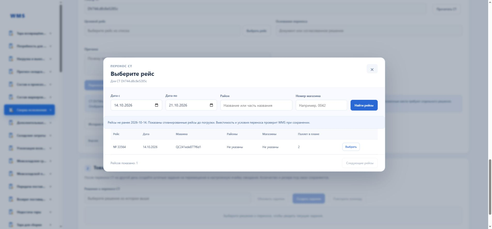

# Выбор рейса при переносе СТ

13 октября 2026, RABAEV/orcl. Реализовано окно выбора существующих рейсов ТМС с фильтрами по периоду дат, району и точному коду магазина. Код магазина сохраняет ведущие нули. Выбор заполняет форму; отдельная команда переноса требует причину и основание.

В реальном браузере выбран рейс 33564 на 14 октября. Перенос не отправлялся. HTTP 794 подтвердил текущий список, исключение исходного рейса, ограничения периода/страницы и пустые результаты для отсутствующих района/магазина. Положительные совпадения двух последних фильтров ещё не подтверждены: у текущего кандидата соответствующие данные отсутствуют.

SQL: заголовки 31–34 мс, пакет остановок 11,5 мс. Решение: сохранить окно до 31 календарного дня, страницы до 100 и пакетную загрузку остановок. Дополнительный индекс пока не вводить. При росте времени поиска транспортный модуль должен снять план и оценить SHIPMENT_DATE/ID; текущий индекс начинается с CREATEDATE. SELECT V$SQL_PLAN недоступен, план выполнения не подтверждён. Остатки не менялись. Все спринты этим блоком не закрываются.
