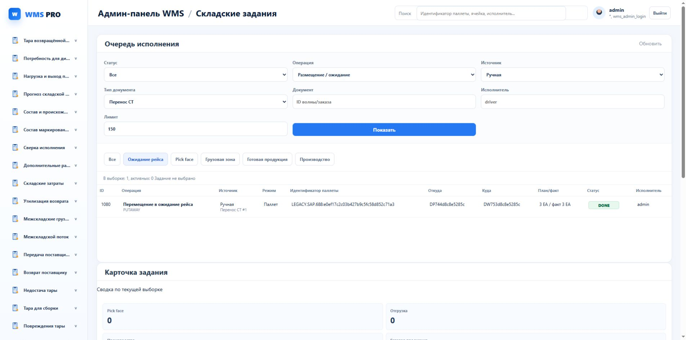

# Продолжение NI07.2: очередь и карточка задания

13 октября 2026. По последнему поручению работа продолжается до завершения всех спринтов либо 20:00 Москвы.

Карточка после обновления использует актуальную серверную запись. Старый статус ASSIGNED не сохраняется при приходе DONE; старый ответ прогресса отвергается. Подтверждённое назначение ресурса отличено от ошибки последующего перечитывания очереди. Поля сканирования и кнопки разнесены по рядам.

Добавлены постоянные ссылки на очереди. В реальном браузере открыто warehouse-tasks.html?preset=waiting: PUTAWAY/MANUAL/ST_DEFER, одна строка1080 DONE, 3 EA / факт3 EA. Это подтверждает загрузку фильтра по URL; клики прежних кнопок через CUA не подтверждены и не выдаются за готовую приёмку.

JS810/828 PASS: прежний выбор фильтра, актуальная карточка и старый progress. Quality gate:24passed, оба TypeScript и architecture686/0cycles/76debt PASS. Было предупреждение прав pytest cache; тесты прошли. UTF8 encoding PASS.

Текущий SQL списка15.701мс/95buffers. Решение: сохранить ограниченную выдачу/фильтры и существующую проекцию, дополнительный индекс не вводить. Вложенное ожидание/CASE/capacity и полный день остаются открыты. Новых движений, назначений ресурсов или внешних ACK этим блоком не создавалось.
