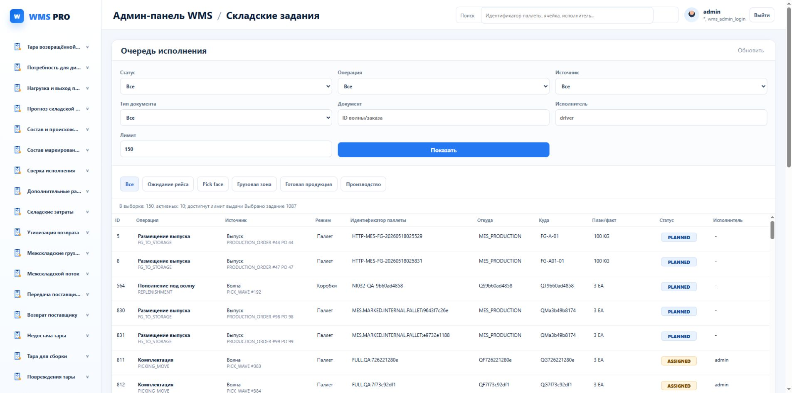

# NI03.2: две подачи и общая паллета

13 октября 2026. Исправлены два подтверждённых пробела: выдача двух заданий на одну целую паллету и лишнее ожидание уже прибывшего общего товара при расчёте вместимости. Используются прежние задания и единственное ядро остатков.

Свежий случай840: отказ вместимости без изменения запасов/резервов; затем два физических задания —1086 на20 EA и1087 на8 EA. ОбаDONE. Сохранены резерв исходного заказа12, второго заказа8 и отдельной волны10. Повтор физических команд возвращает сохранённый результат. После случая свой тестовыйP/H очищен штатными командами; история заданий сохранена.

Браузерный DOM и HTTP подтвердили1087 DONE/план-факт8EA/остаток0/disabled. Скриншот показывает очередь; карточка прочитана ниже экрана. Это не фото физического сканирования.

Полный quality gate845 PASS24/обаTypeScript/architecture688-0-76/UTF8; предупреждение pytest cache rights не скрыто. После дополнительного сужения maintenance до суммарных200 строк847 PASS bound/currentWARE в mock; положительный live840 выполнен до этого сужения.

SQL maintenance17.55мс/126buffers, discovery26.163мс/84. Решение: сохранить bounded200, индекс сейчас не добавлять. Полный спринт/независимая маркированная конкуренция ещё открыты. Новых реестров/копий Oracle/государственныхACK нет.
