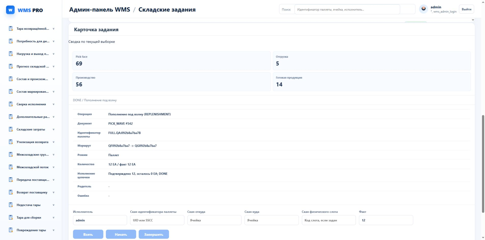

# NI03.2 — частично обеспеченный заказ общей паллеты

На dev RABAEV/orcl применена migration852. Вместимость считает общую целую паллету один раз, обычные количественные задания остаются отдельными. Inventory продолжает невыданное ожидание в статусах RELEASED и QUEUED: сохраняет уже прибывший резерв и направляет недостающую потребность через существующий выбор источника.

Фактический свежий случай: задания1096 и1097 выполнены на20 и12 EA. Сохранены резервы заказов12 и8 EA, отдельной волны14 EA. Вместимость0.1 отказала без изменения остатков; вместимость0.5 разрешила движение. Повтор каждой физической команды вернул сохранённый результат. Все собственные остатки и активные резервы затем очищены штатными командами, история сохранена.

Второе физическое задание принадлежит более раннему заказу общей паллеты; продолжение первого заказа не должно получать дубликат. При подготовке второго источника свободный товар в отборе дополнительно уменьшил недостающее количество второго заказа с4 до2 EA. Проверяется итоговый резерв8, а не выдуманная неизменность промежуточной потребности.

Это адресное исполнение разработчика, не независимая приёмка полного спринта. Маркированный и weighted-capacity варианты, независимая конкуренция остаются открыты.

Реальный браузер: DONE, план/факт12 EA, остаток0, ссылка открывает карточку после загрузки.
