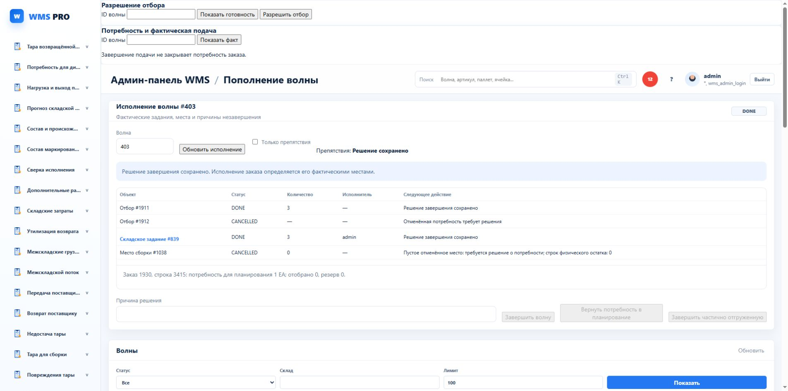

# Экран исполнения волны

860–864 сохраняют существующие GET execution / POST finish-execution и native WAVE_EXECUTION_FINISH. Никакой второй реализации запуска/отгрузки/остатка не вводится.

Wave-execution controller, view и scoped intent разделены. Выбранная волна обновляет панель; прямой wave_id открывает исполнение даже вне первых100 строк очереди. Таблица причин содержит ссылки на реальные warehouse tasks. Потребность planning остаётся отдельно от отгруженного факта. Исторические причины у DONE подписаны как исторические; кнопки нового завершения запрещены.

Read responses сверяются с номером волны и actor/API scope; stale response игнорируется. Saved pending schema whitelist разрешает только wave, operation_id и допустимые disposition/reason. Пока есть pending, новый body/волна не создаются. Cross-tab raw compare и scope compare сохраняют исходник. POST success должен подтвердить ту же wave/operation/DONE/completed; потерянный/неподходящий ответ сохраняет исходный запрос. Повреждённый raw блокирует writes; архив сохраняет исходник до удаления и server reread.

Progress panel теперь показывает таблицу per-SKU BASE: demand/planned/confirmed/unfulfilled/pick remaining/capacity. Selection и identity guards, явный лимит50; отсутствие rows не объявляется исполнением заказа. Панели перенесены внутрь рабочего layout.

Фактический read859 / browser863 для защищённой wave403: DONE, warehouse839 DONE3, cancelled original order1930/line3415 planning1EA. Команды не отправлялись, данные не менялись. Screenshot11 — реальный браузер до финального CSS/подписи historical; не заявлять новый native end-to-end. JS861 PASS intent malformed/other-tab/context/archive. Разработчик, не независимая приёмка спринта.

SQL857 по последнему NI03.2 case: canonical projection17.832ms/136 buffers, cancel12.596ms, partial12.291ms/184 buffers; continuation2.783ms. Более старый projection102ms/241buffers: сохраняем bounded windows, владелец resources; при устойчивом>500ms проверить план/статистику. Новые индексы не обоснованы.

