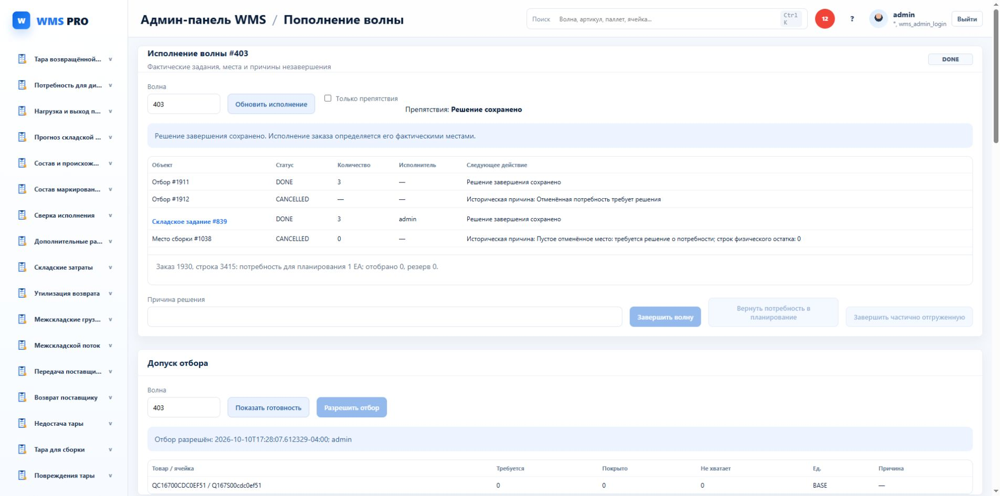

# Допуск отбора и восстановление запроса

877 applied, USER_ERRORS[]/INVALID[]. Fresh879 wave551/private task1104 DONE20 after original ensure_wave_case_pick_tasks: admin scoped preview ready, native/service release and exact service replay PASS. Existing QA172_KRO active in anotherWARE: scoped preview403 and direct command20882/WAVE_CURRENT_WARE_FORBIDDEN. After owncleanup, service881 original replay still accepted for admin and refused for foreign actor before replay. No P/H movement on replay.

First879 lacked the existing CASE metadata preparation because the stock-focused fixture used Root launch directly; readiness correctly refused. Added original CasePickService helper; no product fallback/guard weakened. Initial881 tried service serialization against earlier direct native body ID and correctly OPERATION_CONFLICT; replaced test with fresh service-origin original ID, exact original material preserved.

Service projection adds command_operation_id correlation, preserving native release_operation_id of the actual first release. UI880 shared scoped intent stores separate existing key prefixes for FINISH/PICK, exact native operation grammar/100 bound; malformed/changed-context/tab records retain original. No second command engine. Browser884 wave403: three panels loaded/current403, finished/released controls disabled, no writes.

Quality882:24 tests, both TS, architecture688/0/76 PASS; pytest-cache permission warning remains. JS861/882 PASS. No full sprint/real scanner/independent concurrency claim. Source case before cleanup read admission only; previous protected403 unchanged.

