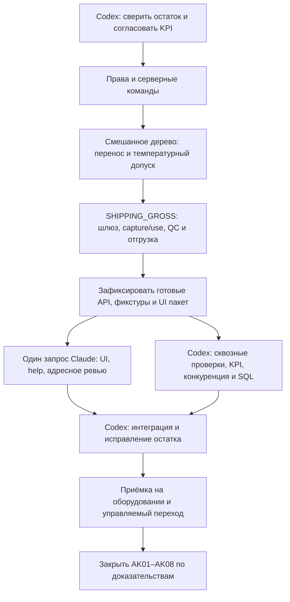

# Завершение AK01–AK08 при одном запросе к Claude Code

Уточнение владельца16.10.2026: текущий вес вводит пользователь, существующие
электронные API сохраняются. Hardware SHIPPING_GROSS больше не блокирует UI.
[C0116 READY](../../coordination/retailcase-claude/API_READY_SINGLE_CLAUDE.md)
передаёт Claude конкретный установленный контракт ручной приёмки, существующей
ручной погрузки, планов консолидации и простых help URL. Это новое условие
перехода для данного пакета вместо ожидания завершения всех блоков1–4 ниже.
Остальные backend/KPI/scoped/CASE interWARE/полная приёмка остаются у Codex.
Получены ACK K-0064 и RELEASE K-0065/K-0066. C0116 интегрирован; root live UI
save/cancel плана и показ акта ручной приёмки прошли. Подробности и остаток —
в текущем результате в конце страницы.

План по поручению владельца15.10.2026. «Только й запрос» трактуется как один запрос.
Это порядок завершения существующих спринтов, не новая нумерация и не обещание
вместить весь остаток в один ответ модели. Новым прямым поручением «приступай к
выполнению плана с1по3» реализация этих блоков возобновлена после прежней границы.
Baseline: [[retailcase_execution_2300_20261015]]. Текущий инкремент:
[[../components/retailcase_queue_scoped_read_20261015]]; весь блок1 ещё не закрыт.

## Принцип работы

Codex — основной исполнитель backend/Oracle/интеграции и оставшегося UI после
единственного результата Claude. Claude получает самостоятельный пакет на уже
готовых API; его доступность не становится условием завершения остальных работ.
Один запрос к Claude экономит повторный контекст, но не гарантирует неограниченный
лимит его исполнения. При исчерпании лимита незавершённый пакет принимает Codex.

## Очередь исполнения

| Блок | Спринты | Codex | Результат/условие перехода |
|---|---|---|---|
| 0. Единый остаток | Все | Для каждого пункта: реализовано/проверено/остаток; сохранить закрытые кейсы; согласовать недостающие правила KPI | Одна матрица без исторических PREPARED как текущего статуса; backlog с владельцами |
| 1. Области прав и команды | AK02–AK05, часть AK06 | recovery-shorts и inventory queues: actor/actualWARE доlimit; остаток native guards для склада, водителя, диспетчера/финансов; замещение/делегирование и запрет самосогласования | WARE/GROUP/GLOBAL, отзыв,2склада/РЦ, прямые API и конкуренция; legacy-группы сохранены |
| 2. Исполнение и смешанная матрёшка | AK06-A/D/E/F | Дозакрыть scoped ASM и продолжение волны; отдельно ожидаемый manifest и физическое дерево; CASE-aware interWARE через прежних владельцев; температурный/зональный допуск; версии/происхождение/тара; handover поддерева магазину | Положительный ASM+BOX+EA путь, нехватка ребёнка/цикл/смена версии/чужой склад/несовместимая температура; ни одного двойного листа |
| 3. Внешний вес паллета | AK06-B/C/F | Довести неустановленный read-кандидат: purity, ранние bounds, release/rollback kit; frozen SHIPPING_GROSS, общий device lease, request/claim/zero/capture/use, raw evidence, native QC/loading consumer | Потеря ответа, повтор Stable/replay, устаревший состав, неверный пост/устройство, параллельный захват; observed/expected/unknown раздельны |
| 4. Источники KPI и готовые контракты | AK07, подготовка AK01/KH | Aware факты и время; delta фактического отбора без дублей; коробки по версии упаковки; доставка в зафиксированное окно и полнота по стратегии магазина; подготовить DTO/examples/errors/help map для Claude | Серверные версии и семантика готовы; pending правила не становятся принятыми; UI не требует ожидания нового API |
| 5. Единственный пакет Claude | KH01–KH07, UI части AK04–AK07 | Передать готовый пакет; параллельно исполнить реальные native/API/rollback/concurrency/load проверки, исправлять SQL по измерениям | Claude возвращает законченный diff, адресные тесты, screenshots, help sources и ограничения; отсутствие ответа не останавливает Codex |
| 6. Интеграция и пилот | AK01–AK08/KH08 | Принять/исправить diff; публикация выбранных знаний локальным механизмом; полная регрессия; реальное оборудование, нагрузка, откат и управляемый legacy cutover | Код и фактический пилот проходят отдельные gates; каждый старый спринт закрывается по своей матрице |

Порядок2→3 нужен для положительного смешанного сценария; базовые части gateway
уже существуют и не переписываются. Контракты KPI и оборудование можно уточнять
во время первых блоков. Общий Гант получает подтверждённые данные всех4семейств,
а не выдуманные полосы. Оценку сроков уточнять после GAP и5принятых изменений.

## Как потратить один запрос Claude

Текущий [промпт C0116](../../coordination/retailcase-claude/PROMPT_CLAUDE_C0116_MANUAL_WEIGHT.txt)
и API_READY_SINGLE_CLAUDE.md созданы по новому поручению16.10. Ожидание блока4
для этого ограниченного пакета отменено: передаются только готовые контракты.
TASK и CODEX_TO_CLAUDE обновлены, C0116 ACK/RELEASE получены; C0115 сохранён как история.

Общий целевой пакет: экраны консолидации/поста весов, старшего
смены/Ганта, магазина/контроля и KPI; связать действия→объект→Гант→контекстную
помощь. Исправить навигацию и мобильную плотность; у каждой кнопки tooltip и
help_id, сложные процессы связаны с локальными статьями/wiki через действующий
механизм знаний. Не строить новый UI framework или второй digital twin.

Чтобы пакет оставался выполнимым, root заранее разделяет обязательные дефекты
и уже принятые экраны. Claude исправляет только перечисленный остаток, а затем
проверяет критические backend инварианты по указанным source/tests. Его ревью
касается зафиксированного среза; последующие правки Codex не становятся повторно
независимо проверенными автоматически. Никаких DDL, реальных товарных POST,
переопределения прав или установки SHIPPING_GROSS силами Claude.

Обмен остаётся через CODEX_TO_CLAUDE/CLAUDE_TO_CODEX/CLAUDE_STATUS и RESULT/RELEASE.
Claude не ждёт новых контрактов/ACK посреди своего блока. Вопросы записывает,
продолжает независимые пункты и возвращает результат в пределах доступного лимита.
Файловый канал не запускает остановленную сессию и не создаёт новые запросы сам.

## Решения владельца перед KPI

Уже принято: строки/час и коробки/час отдельно за фактическую сборку и за смену;
паузы исключаются только из времени сборки. Вовремя — плановое окно; полнота —
подтверждение магазином по весу, пересчёту либо сканированию.

Согласовано владельцем16.10: строка — завершившему сотруднику, коробки — каждому по собственным отборам; с плановым окном сравнивается прибытие машины в магазин; полнота — подтверждённое магазином полное принятое количество без недостачи/отказа/повреждений. Завершённая приёмка с расхождениями показывается отдельно и в числитель полноты не входит. Исключения/отмены, неполные коробки, доказательство прибытия и runtime-источники времени остаются отдельными задачами; это согласование правил не означает готовность всего KPI-адаптера.

## Закрытие исходных спринтов

| Спринт | Последний обязательный gate |
|---|---|
| AK01/KH01 | Действия/help_id, доступ к статьям и связям, возврат в рабочий экран |
| AK02/KH02 | Одновременные назначения/редактирование знаний, срок/отзыв, история |
| AK03/KH03 | Все выбранные native команды соблюдают действующую область до эффекта |
| AK04/KH04 | Второй пользователь, мандат/замещение/делегирование и прямые API-запреты |
| AK05/KH05 | Полный диспетчерский/финансовый цикл нескольких РЦ, выгрузки и отказ чужому |
| AK06/KH06 | Сборка→смешанное дерево→контроль→отгрузка→стратегия приёмки;4семейства Ганта |
| AK07/KH07 | Согласованные KPI с drill-down к фактам, коррекции и защита от повторов |
| AK08/KH08 | Конкуренция/нагрузка/slow SQL, доступность/offline-read справки, оборудование, восстановление и откат |

Для AK08 нужны выбранные совместимые весы/сервер или шлюз OPC40200, реальный
сканер/телефон и участники пилота. До их испытаний программная приёмка может
быть завершена, аппаратный пилот остаётся открытым. Состояние не подменять mock.
GitHub и внешняя публикация по-прежнему требуют отдельного прямого поручения.

## Current C0116 outcome 2026-10-16

Actual ACK K-0064 and RELEASE K-0065/K-0066 received. [Result](../../coordination/retailcase-claude/RESULT_C0116.md) integrated: manual store weight, existing loading help, expected consolidation list/editor and shift navigation. Root live UI save/cancel isolated future plan and production manual receipt act PASS; both builds and gate PASS. See [[../database/retailcase_manual_weight_20261016]]. Previous ACK-pending wording above is historical.

CASE1143 full accepted shortage disposition/own tare/wave574 blocker closed: [[../database/retailcase_empty_short_disposition_20261016]]. Remaining blocks1-3: scoped manager/HU/driver/dispatcher/finance and delegation matrix; CASE-aware interWARE/subtree handover; future electronic SHIPPING_GROSS freeze/capture consumer. Manual weight satisfies current UI request while electronic APIs remain. No new Claude request needed for completed C0116; full sprint/pilot acceptance stays open.
